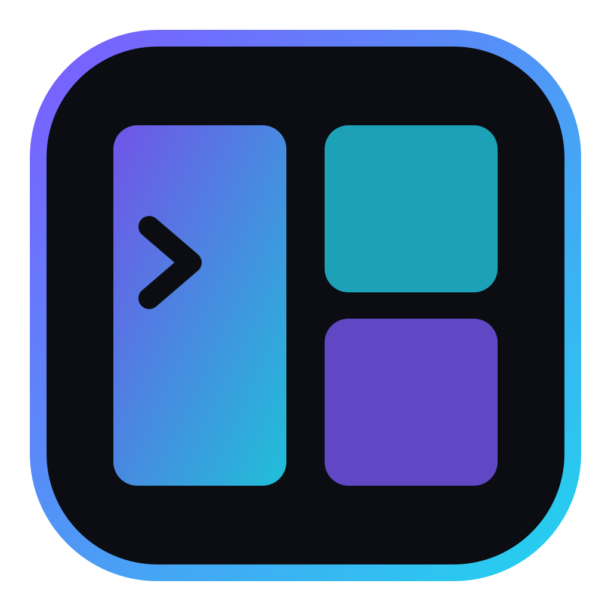
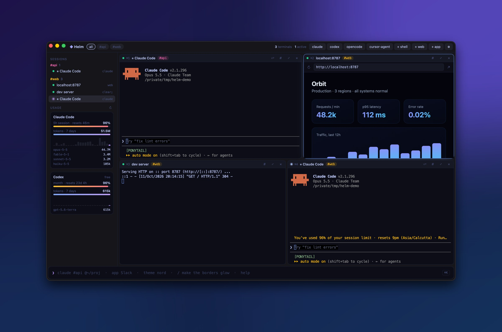
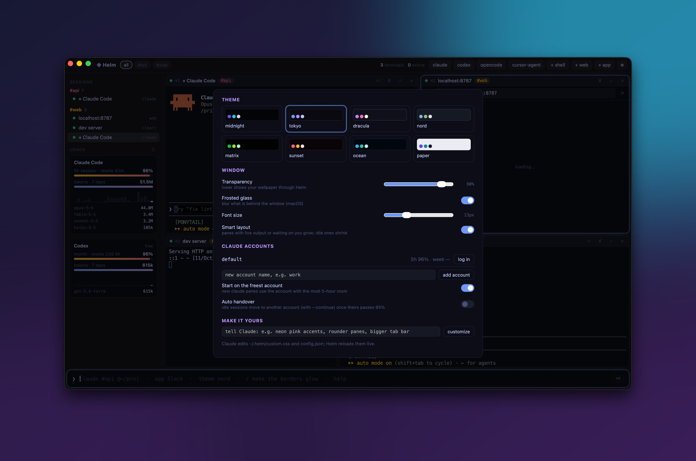
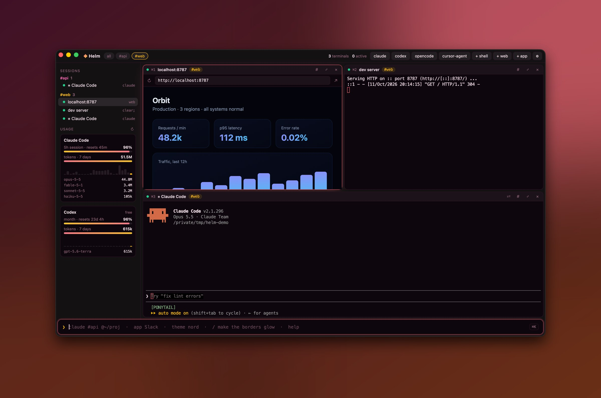
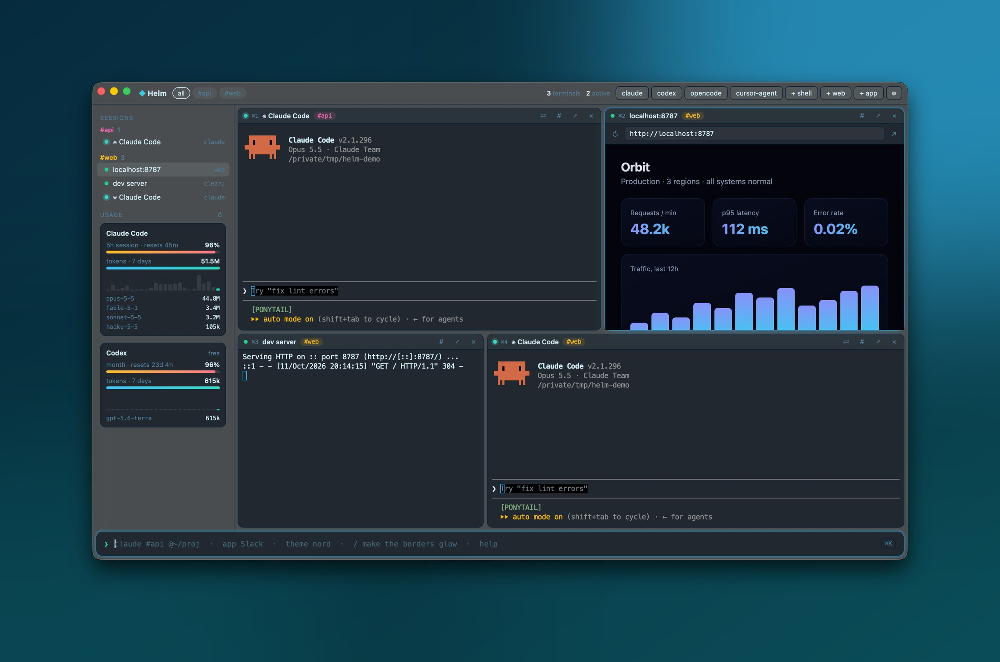

<div align="center">



# Helm: the terminal command center for Claude Code, Codex & AI coding agents

### Run every AI agent, terminal and browser in one window. Split, tag, route, and watch your usage limits live.

<p>
<a href="https://github.com/mdayan8/helm-terminal/releases/latest"></a>
<a href="https://github.com/mdayan8/helm-terminal/releases/latest"></a>
<a href="https://github.com/mdayan8/helm-terminal/releases/latest"></a>
</p>

<p>


<br>


<a href="LICENSE"></a>
<a href="https://github.com/mdayan8/helm-terminal/stargazers"></a>
</p>

<p>
<a href="https://x.com/meaynx"></a>
<a href="https://x.com/intent/post?text=Helm%3A%20one%20window%20for%20every%20Claude%20Code%2C%20Codex%20and%20AI%20agent%20terminal%2C%20with%20live%20usage%20limits%20and%20account%20rotation.%20Open%20source%2C%203%20MB%2C%20Rust.%20by%20%40meaynx&url=https%3A%2F%2Fgithub.com%2Fmdayan8%2Fhelm-terminal"></a>
</p>



<sub><b>Free and open source · macOS, Windows, Linux · built by <a href="https://x.com/meaynx">@meaynx</a></b></sub>

</div>

---

**Helm** is a free, open-source **terminal command center for AI coding agents**. Run **multiple Claude Code sessions**,
**OpenAI Codex CLI**, **Gemini CLI**, OpenCode, Aider, Cursor Agent and any other terminal tool **side by side in one window**.
They tile automatically, you tag and route them, a real browser pane sits next to your terminals, and the sidebar shows your
**live Claude Code usage limits** (5-hour session and weekly %) and **Codex rate limits**.
When one Claude account runs low, Helm **rotates the session to another account** and carries the conversation over.

It's a native **Rust + Tauri** app: **3.3 MB**, no bundled Chromium, starts instantly.

> **Why another terminal?** tmux, Zellij, Warp and iTerm2 are great terminals, but none of them knows an agent is waiting on you,
> how close you are to your Claude limit, or which account has room left. Helm is built around exactly that.

## Contents

- [Features](#features) · [Download](#download--install) · [Command bar](#the-command-bar) · [Shortcuts](#keyboard-shortcuts)
- [Usage limits & account rotation](#claude-code-usage-limits--account-rotation) · [Customize](#customize-helm-by-asking-claude)
- [Helm vs tmux, Zellij, Warp, iTerm2](#helm-vs-tmux-zellij-warp-and-iterm2) · [FAQ](#faq) · [Roadmap](#roadmap)

## Features

|  |  |
|---|---|
| 🤖 **Every AI agent, auto-detected** | Finds `claude`, `codex`, `gemini`, `opencode`, `aider`, `cursor-agent`, `amp`, `goose`, `qwen`, `droid`, `crush` and `copilot` on your PATH and gives each a one-click launcher. Any other CLI works too. |
| 🪟 **Auto-tiling split panes** | New panes split the focused pane along its longer side. Drag a header onto another pane's edge to re-split, or onto its centre to swap. `layout grid` re-tiles everything. |
| 🧠 **Smart layout, zero tokens** | Panes that are printing output or waiting on you grow, and idle ones shrink. Plain rules, no AI calls. |
| 🏷️ **Tags and routing** | Tag panes `#api`, `#web` and so on. `view #api` shows only that group. `send #api run the tests` types into **every agent in the group at once**. |
| 🌐 **Browser panes** | Real webviews (not iframes) next to your terminals. Clicking a link in a terminal opens it in a split. Drop a link from your browser onto a pane edge to open it there. |
| 📊 **Live usage limits** | Your actual **Claude Code 5-hour and weekly %** with reset countdowns, **Codex limits**, tokens per model, and a 24-hour activity sparkline. |
| 🔄 **Claude account rotation** | Add more Claude accounts. New sessions start on the one with the most room. `⇧⌘R` moves a running session to another account with `--continue`. Optional auto-handover at 95%. |
| 🎨 **Themes and glass** | 8 themes (midnight, tokyo, dracula, nord, matrix, sunset, ocean, paper), see-through window, frosted glass, live font size. |
| 💬 **Customize by asking Claude** | Type `/ neon pink accents, rounder panes` and Claude restyles Helm. It reloads in about 2 seconds. |
| 🚀 **Launch desktop apps** | `app Slack`, `open Claude`, `app Visual Studio Code` from the same command bar. |
| 📥 **Adopt open terminals** | `adopt` pulls the tabs already open in Terminal.app / iTerm2 into Helm. Agents resume their conversation. |
| 🔔 **"Needs you" alerts** | A pane that rings the bell glows amber until you look at it, and the title bar counts how many agents are waiting. |
| 💾 **Session restore** | Layout, tags, accounts and commands come back on launch. |
| ⚡ **Tiny and native** | Rust PTYs (`portable-pty`), xterm.js with WebGL rendering, system webview. **3.3 MB** on macOS. |

<table>
<tr>
<td></td>
<td></td>
</tr>
<tr>
<td align="center"><sub>Themes, glass, Claude accounts, "tell Claude" customization</sub></td>
<td align="center"><sub><code>view #web</code>: one group, auto-gridded (sunset theme)</sub></td>
</tr>
</table>

## Download & install

| Platform | Get it |
|---|---|
|  | `.dmg` for Apple Silicon or Intel from **[Releases](https://github.com/mdayan8/helm-terminal/releases/latest)** |
|  | `-setup.exe` or `.msi` from **[Releases](https://github.com/mdayan8/helm-terminal/releases/latest)** |
|  | `.AppImage`, `.deb` or `.rpm` from **[Releases](https://github.com/mdayan8/helm-terminal/releases/latest)** |

macOS builds aren't notarized yet. After installing, run this once:

```bash
xattr -dr com.apple.quarantine /Applications/Helm.app
```

**Build from source** (needs Rust and Node 18+):

```bash
git clone https://github.com/mdayan8/helm-terminal && cd helm-terminal
npm install
npm run dev      # hot-reloading dev build
npm run build    # installer in src-tauri/target/release/bundle
```

## The command bar

Press **⌘K** and type. Tab completes, ↑ / ↓ walks history.

```text
claude                         new Claude Code pane (auto-tiled)
3x claude #api @~/code/api     three Claude Code agents, tagged api, started in ~/code/api
codex #api                     OpenAI Codex CLI in the api group
claude !work                   start on a specific Claude account
npm run dev [server]           any command, in a pane titled "server"
web localhost:3000             browser pane
app Slack                      launch a desktop app
adopt                          bring Terminal / iTerm tabs into Helm

send #api run the test suite   type into every pane tagged api   (* = all, 2 = pane 2)
> git status                   type into the focused pane
view #api   ·   view all       show one group, auto-gridded
layout grid | cols | rows      re-tile
close   ·   close #api         close focused / a whole group

theme nord · opacity 70 · blur on · font 14 · auto off
account add work   ·   rotate
/ make the active pane glow    ask Claude to restyle Helm
```

## Keyboard shortcuts

| | |
|---|---|
| `⌘K` command bar | `⌘,` settings · `⌘/` help |
| `⌘T` new shell | `⌘D` / `⇧⌘D` split right / down |
| `⌘W` close pane | `⌘↩` zoom pane · `⌘B` sidebar |
| `⌘1–9` jump to pane | `⌘[` `⌘]` cycle · `⇧⌘R` rotate account |

Shortcuts are native menu accelerators, so they work even while a browser pane has focus.
On Windows and Linux they use `Ctrl+Shift` so plain `Ctrl` keys still reach your terminal.

## Claude Code usage limits & account rotation



- **See your real Claude Code limits.** Helm shows the same 5-hour session % and weekly % that `/usage` does, with reset countdowns.
  Your login token is read locally (Keychain on macOS, `~/.claude/.credentials.json` elsewhere) and only ever sent to
  `api.anthropic.com`, through curl's stdin so it never appears in the process list.
- **Codex rate limits** come straight from the Codex CLI's own session logs.
- **Rotate accounts when you hit the limit.** `account add work` opens a pane where you run `/login`. Accounts live in
  `~/.helm/accounts/<name>` and are passed to Claude Code as `CLAUDE_CONFIG_DIR`. Session history is shared between them,
  so `claude --continue` picks up the same conversation after a switch.
- **Tokens and models** are read from local logs. Nothing leaves your machine. No telemetry, no account, no server.

## Customize Helm by asking Claude

Everything about Helm's look is in `~/.helm`:

```text
~/.helm/config.json    theme, opacity, blur, font size, layout and account toggles
~/.helm/custom.css     your overrides, applied last
~/.helm/CLAUDE.md      the guide Claude reads when you type "/ <request>"
```

Type `/ make it look like a synthwave poster` in the command bar. Claude Code opens in `~/.helm`, edits the files, and Helm reloads live.

## Helm vs tmux, Zellij, Warp and iTerm2

| | Helm | tmux / Zellij | Warp | iTerm2 |
|---|:---:|:---:|:---:|:---:|
| Split panes & tiling | ✅ auto | ✅ manual | ✅ | ✅ |
| Detects AI agents, one-click launch | ✅ | — | partial | — |
| Shows which agent is waiting on you | ✅ | — | — | — |
| Live Claude Code / Codex usage limits | ✅ | — | — | — |
| Claude account rotation with `--continue` | ✅ | — | — | — |
| Broadcast a prompt to a group of agents | ✅ `send #tag` | `synchronize-panes` | — | broadcast input |
| Browser pane next to terminals | ✅ | — | — | — |
| Open source | ✅ MIT | ✅ | — | ✅ |
| App size | **3.3 MB** | tiny (CLI) | ~300 MB | ~60 MB |

Helm isn't trying to replace tmux on a server. It's for the desk where you're running five agents at once.

## FAQ

**How do I run multiple Claude Code sessions at the same time?**
Install Helm and type `3x claude` in the command bar (⌘K). Each session gets its own pane, auto-tiled. Add `#tag` to group them and `@~/path` to set the folder.

**How do I check my Claude Code usage limit?**
Helm's sidebar shows your live Claude Code 5-hour session % and weekly %, with time until reset, refreshed every 3 minutes. It's the same data `/usage` shows.

**What do I do when Claude Code hits the usage limit?**
Add a second account with `account add work`, then press `⇧⌘R` on the pane. Helm restarts the session on the account with the most room, using `claude --continue` so your conversation carries over. Turn on auto-handover to do this automatically.

**Is there a tmux alternative for AI coding agents?**
Yes, that's what Helm is: split panes and tiling like tmux, plus agent detection, "needs you" alerts, usage limits and prompt broadcasting to groups of agents.

**Does Helm work with OpenAI Codex CLI, Gemini CLI, OpenCode, Aider or Cursor Agent?**
Yes. Anything that runs in a terminal runs in Helm, and the common agent CLIs are detected automatically.

**Can I send one prompt to several agents at once?**
Yes: `send #api write tests for the auth module` types it into every pane tagged `api`. `send * …` sends to all panes.

**Is Helm free?**
Yes. It's open source under the MIT license, with no account and no telemetry.

**Which platforms does it support?**
macOS (Apple Silicon and Intel), Windows and Linux. Downloads are on the [Releases](https://github.com/mdayan8/helm-terminal/releases/latest) page.

## How it's built

```text
src-tauri/src/main.rs   Rust: PTYs, agent detection, usage + limits, accounts, app launching, menu hotkeys
ui/app.js               layout tree, panes, command bar, smart layout, settings, usage panel
ui/style.css            every colour is a theme variable
```

Tauri 2 · portable-pty · xterm.js (WebGL) · no frontend framework, no bundler.

## Roadmap

- [ ] Codex account rotation
- [ ] Named workspaces (save and restore a whole layout by name)
- [ ] Signed and notarized macOS builds
- [ ] Desktop notifications when an agent finishes

PRs and issues welcome.

---

<div align="center">

### Built by [@meaynx](https://x.com/meaynx)

If Helm saves you a few tab switches, **⭐ star the repo** and **[share it on X](https://x.com/intent/post?text=Helm%3A%20one%20window%20for%20every%20Claude%20Code%2C%20Codex%20and%20AI%20agent%20terminal%2C%20with%20live%20usage%20limits%20and%20account%20rotation.%20Open%20source%2C%203%20MB%2C%20Rust.%20by%20%40meaynx&url=https%3A%2F%2Fgithub.com%2Fmdayan8%2Fhelm-terminal)**. It helps other people find it.

<a href="https://x.com/meaynx"></a>

<sub>MIT licensed · Helm terminal · AI agent terminal · Claude Code multiple sessions · Claude Code usage tracker · Codex CLI · tmux alternative for AI agents</sub>

</div>
